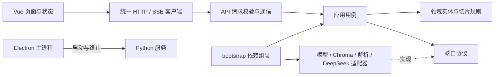

# 架构与依赖边界

Edge Assistant 定位为电脑本地助手，是 Electron 桌面应用与本地 Python 服务组成的双进程系统。当前提供文档与图片检索、独立图片识字、带来源的问答、知识库管理和设置。产品迭代边界见 [产品方向](product.md)。

## 分层

| 层           | 位置                                        | 可以依赖                      | 职责                                                 |
| ------------ | ------------------------------------------- | ----------------------------- | ---------------------------------------------------- |
| 页面与组件   | `apps/desktop/src/features`                 | 特性状态、共享接口、类型、Vue | 展示、输入、反馈                                     |
| 前端应用入口 | `apps/desktop/src/app`                      | 页面、Router、Pinia、共享接口 | 布局、启动连接、当前知识库                           |
| 前端通信     | `apps/desktop/src/shared/api`               | Web API、共享类型             | HTTP、认证头、SSE、取消请求                          |
| 桌面宿主     | `apps/desktop/electron`                     | Electron、Node                | 窗口、子进程、端口、健康检查、退出                   |
| HTTP 接口    | `backend/src/edge_knowledge/api`            | 应用层、领域、FastAPI         | 请求校验、鉴权、错误映射、序列化、SSE                |
| 应用层       | `backend/src/edge_knowledge/application`    | 领域、标准库、端口协议        | 入库、去重、检索、准备回答、流式事件                 |
| 领域层       | `backend/src/edge_knowledge/domain`         | 标准库                        | 实体、切片规则、业务错误                             |
| 基础设施     | `backend/src/edge_knowledge/infrastructure` | 领域、外部库                  | 文件/图片处理、OCR、素材存储、模型、Chroma、DeepSeek |
| 依赖组装     | `backend/src/edge_knowledge/bootstrap.py`   | 所有后端层                    | 唯一实例组装入口                                     |

应用层的端口定义在 `application/ports.py`，生产适配器在启动时注入。业务用例不认识 FastAPI 路由、Chroma 集合对象或 OpenAI SDK。数据库替换、模型替换和接口替换都应遵守这个边界。测试使用独立的适配器替身，生产模式不会降级为伪造向量。



箭头表示代码依赖，虚线表示接口实现。适配器虽然在运行时被用例调用，但用例只依赖端口协议。

## 多模态与资料整理分层

`domain/multimodal.py` 定义通用输入、共享预算与向量运算；`application/semantic.py` 负责联合索引、跨模态检索、分类/聚类/查重、可恢复暂存。其编码、解码、原件与快照存储依赖 `application/ports.py` 的协议。PyAV、Pillow、numpy、torch 和模型仅在基础设施中使用，API 不直接操作媒体解码器或模型。

完整模型加载文本、视觉和音频编码器。媒体处理适配器以 24 秒窗口输出本地字节域对象，保留起止时间；应用层不接触文件路径、numpy 或 codec 对象。领域预算预留格式空间，模型适配器核对处理器实际长度并拒绝超限输入。知识库事务协调索引、原件、删除和恢复，避免跨用例竞态。

检索索引保留 768 维向量，MRL 查询按相同维度截取并重新归一化。整理任务重新以各自前缀编码，不能拿非对称检索向量冒充分类/聚类表示。暂存只从活动索引移除，保留私有原件和索引快照；恢复无需重新推理。具体边界与验收见 [多模态攻略](multimodal-guide.md)。

## 数据流

**导入**：页面上传 → API 限制文件大小 → KnowledgeService 清理文件名与计算内容 ID → 解析 → 领域切片 → 本地嵌入 → Chroma 写入。内容 ID 同时包含文件名和文件内容，同名不同内容保留为不同版本；同名同内容跳过。批次写入失败时删除本次文档的片段，避免残缺文档出现在列表中。

**图片导入**：ImageService 通过独立端口完成格式校验、方向修正、缩略图与本地 OCR；KnowledgeService 分别生成图片向量与 OCR 文字向量，保存素材后写入 Chroma。索引失败清理本次素材。图片没有文字时仍可检索和查看，但不能作为已解读的文字证据。

**独立识字**：`/api/ocr` 只调用图片处理与 OCR，用于提取文字和区域；不加载嵌入模型、不写索引或素材、不调用云端。

**问答**：问题与知识库 ID → 本地查询嵌入 → Top-K 余弦检索 → 相关度过滤 → 准备来源与提示词 → DeepSeek 生成 → 来源 / 证据说明 / 增量 / 完成事件。没有相关资料时本地返回提示，不调用 DeepSeek。每个问题重新检索，可用当前对话中最近的用户问题补充检索语义；生成时发送最多 10 条、合计 24000 字符的同一对话上下文。历史回答只帮助理解追问，不作为本次资料证据。

**删除**：根据知识库和文档 ID 删除对应的全部片段及本地图片素材，之后查询不会再检索它们。

## 会话、引用与界面偏好

`features/chat` 管理会话、输入建议与引用交互；`shared/preferences` 保存主题、配色、字体、字号、语言和发送快捷键，`shared/i18n` 提供界面文案。设置的主题预览组件与样式放在 `features/settings`，设置按功能分区展示；应用入口只组装布局，页面仍通过统一客户端访问后端。

`@` 与 `/reference` 选择已入库文档 ID，最多 10 份；KnowledgeService 在嵌入前校验它们均属于当前知识库，仓储在向量检索时过滤文档 ID。引用限定相关片段的检索范围，不直接把整个文件发送到云端。失效或跨库引用返回明确错误，不扩大到全库。

新建或切换会话会取消进行中的请求，答案始终写入发起请求的会话；删除不影响资料库，并可立即撤销。每次图片上传授权仍独立，不因会话保存或历史上下文自动复用。

## 运行边界

- Electron 在启动时产生随机会话令牌，Python 绑定 `127.0.0.1` 的动态端口。端口由已经绑定的 socket 宣告，避免“先找空端口再启动”的竞争。
- preload 提供 `getBackendSession()` 与窄文件授权操作（选择、列出、扫描、导入、撤销），仅主窗口的主 frame 能调用。返回本地服务地址与会话令牌，不包含 DeepSeek Key。
- 渲染进程启用隔离与 sandbox，禁用 Node 能力、远程导航、弹窗和权限申请。
- DeepSeek Key 的设置输入短暂存在于页面内存，提交后清空。后端仅返回是否配置。`settings.json` 以 0600 权限原子写入普通参数；密钥通过 `CredentialStore` 端口存入系统凭据库，旧明文在成功写入并回读后移除。拒绝访问不回退明文，迁移失败保留旧文件并提示。
- 生成目的地址限制为官方 DeepSeek HTTPS 地址，避免设置误写后向其他站点发送资料。
- 模型须先通过准备脚本下载并校验，未就绪时请求快速返回提示；首次推理延迟加载本地文件，锁避免并发加载和推理。默认启用完整文本、视觉和音频编码器，使用 float32，禁止 fp16。`EDGE_IMAGE_EMBEDDINGS=false` 可关闭视觉编码器。
- Chroma 按嵌入模型隔离命名空间，知识库按集合隔离。模型名称改变后不会读取旧模型的向量库。模型权重路径/名称配置放在运行配置中，暂不提供页面切换。
- 退出时先发送 SIGTERM，五秒后仍未退出才发送 SIGKILL；后端异常退出会显示错误并退出桌面程序。
- 导入和检索通过线程池执行，不占用 HTTP 事件循环。一个 KnowledgeService 内的导入、检索、删除由锁串行保护。入库按请求处理；长素材逐段编码，有进行中与停止等待反馈，尚无后台作业队列。

## 数据存放

Electron 使用系统的应用数据目录；macOS 通常位于 `~/Library/Application Support/edge-knowledge/`，具体以 Electron `app.getPath('userData')` 为准。

```text
knowledge-dev/ 或 knowledge/
├── settings.json    # 用户配置与密钥
├── chroma/          # 片段、元数据、向量索引
├── assets/          # 按模型与知识库隔离的规范化图片、缩略图、OCR 区域
└── models/          # 固定 revision、校验过的本地模型与缓存
```

独立后端默认使用项目 `data/`。文本原文件不保留，Chroma 保存文字片段。图片保留经方向修正、去除元数据的 PNG、缩略图与 OCR 区域记录，素材文件以 0600 权限保存。界面偏好与会话以独立版本化结构保存在当前应用配置的 localStorage 中；会话按知识库隔离，保存名称、消息、来源与引用范围。API Key 不进入前端持久化。存储失败显示提示，用户可导出当前对话为 Markdown。浏览器开发与 Electron 的配置目录独立。设置中的切片参数只影响新导入的文档。

## 图片检索与生成能力分流

本地多模态嵌入负责找到图片，不会把图片转换成文字，也不能把向量直接交给文本生成模型理解。应用层需要区分以下任务：

| 任务                     | 所需能力         | 数据流                                                   |
| ------------------------ | ---------------- | -------------------------------------------------------- |
| 找到图片/截图            | 多模态嵌入与检索 | 本地查询 → 命中图片 → 显示缩略图和来源，不调用生成模型   |
| 阅读截图、票据图片       | OCR + 文本生成   | 本地图片 → OCR 文字与位置 → 文本生成模型回答             |
| 理解照片、图表、空间关系 | 视觉理解         | 当前为用户逐次授权的云端视觉模型；本地通用视觉模型待实现 |

2026-10-12 查询官方文档，DeepSeek 的 `deepseek-flash` 已支持图片输入，见 [Vision 指南](https://api-docs.deepseek.com/guides/vision/)。因此不能把“DeepSeek”整体标记成文本模型；模型能力应按提供商、具体模型及其接口确定。当前适配器按具体模型声明图片能力，已支持文本内容与 inline 图片内容块；尚未验证真实账户的视觉调用。

由应用层的能力路由决定：`检索 → 选择相关证据 → OCR/视觉理解 → 生成回答`。图片处理、OCR、素材存储各自实现独立端口；生成适配器声明支持的输入类型。未支持图片的模型接收经过提取的文字证据，不能收到图片向量，也不能把无法解读的图片包装成已经理解的内容。

默认沿用本地处理图片、向生成服务只发送相关文字证据的路径。用户选择云端视觉模式后，每次提问仍须勾选图片发送授权，后端在读取附图前再次验证，最多发送 3 张相关图片。OCR 文字与规范化图片保留来源，OCR 区域采用左上角原点的归一化坐标；需要精确数字或图表关系时，普通图片描述不能替代相应证据。

## 当前边界与后续演进

| 能力       | 当前处理                                   | 后续演进                                   |
| ---------- | ------------------------------------------ | ------------------------------------------ |
| 文档元数据 | Chroma 元数据聚合                          | 文档量大时引入 SQLite 元数据仓储与分页     |
| 长任务     | 上传请求内处理，有进行中提示               | 作业队列、进度事件、取消入库               |
| 模型获取   | 显式下载固定 revision、断点恢复与摘要验证  | 应用内模型管理与任务进度页                 |
| PDF        | 文字层提取                                 | OCR 与页码引用                             |
| DOCX       | 段落与表格提取                             | 按原始顺序、标题层级和复杂版式优化         |
| 聊天       | 独立检索、持久化多会话、有限上下文         | 全文搜索会话、存储迁移与更精细的上下文预算 |
| 打包       | PyInstaller onedir + electron-builder 配置 | 单独验证 arm64/x64、签名、公证、模型分发   |

## 边界如何验收

`backend/tests/test_domain_and_storage.py` 自动检查后端依赖方向。接口集成测试使用实际 Chroma，验证知识库隔离、持久化、去重、删除、错误处理和密钥不回传。DeepSeek 适配器通过真实 SDK 与模拟 HTTP 响应验证流式/非流式行为。桌面进程测试实际启动 Python 子进程并验证认证与退出。SSE 测试按单字节拆分中文和 CRLF，验证不丢失、不重复。

## 官方依据

- [EmbeddingGemma 2 模型说明](https://huggingface.co/google/embeddinggemma-2)：任务前缀、关闭未使用编码器、float32/bfloat16 与禁止 fp16。
- [Chroma 集合配置](https://docs.trychroma.com/docs/collections/configure)：显式设置余弦距离。
- [DeepSeek Chat Completions](https://api-docs.deepseek.com/api/create-chat-completion/)：流式增量与非流式响应。
- [Electron 进程沙箱](https://www.electronjs.org/docs/latest/tutorial/sandbox)：隔离 preload 与渲染进程权限。

## 本地目录授权边界

`features/access` 展示授权、扫描预览与导入状态，只调用 `shared/api/client.ts`。客户端将本地操作转交给窄 preload bridge；`shared/types/access.ts` 是双方共享的纯数据协议。页面不导入 Electron 或 Node。

桌面主进程验证 IPC sender 与主 frame，只允许原生选择器创建授权。`electron/access.ts` 保存只读位置，renderer 在扫描和导入时只提交授权 ID 与临时文件 ID，不能指定任意路径。主进程读取授权文件并通过现有认证接口导入本地后端；不向 renderer 传递额外的文件字节或密钥。

授权记录位于当前桌面数据目录的 `local-access.json`，以私有权限原子写入。扫描跳过隐藏文件、符号链接、依赖目录和不支持/超限文件，手动预览最多返回 100 个候选，遍历最多 2000 个条目和 32 层目录。手动批量导入最多 512 MB；每个文件再次校验规范路径、inode、设备、大小和修改时间，使用不跟随最终符号链接的只读文件描述符及有界缓冲区。失效扫描不能复用，撤销授权使后续读取失败。已交给本地后端的单文件请求可能完成，已入库副本不随撤销自动删除。

应用范围授权不替代操作系统权限，也没有设置完全磁盘访问或修改系统隐私设置。当前普通 Electron 桌面发行方式使用系统文件选择器；Mac App Store 沙盒发行还需要另行接入 security scoped bookmarks 与相应签名能力。依据 [Electron 原生文件选择器文档](https://www.electronjs.org/docs/latest/api/dialog)。

会话的系统能力采用默认拒绝：麦克风、摄像头、屏幕捕获和通知不可访问。只允许本窗口写入已净化的剪贴板内容以支持“复制文字”，不开放剪贴板读取。权限请求和权限检查均设置处理器，依据 [Electron Session 文档](https://www.electronjs.org/docs/latest/api/session)。

## 备份与凭据分层

系统凭据适配器与版本化 ZIP 编解码器只在 bootstrap 组装。备份用例通过仓储快照、图片快照、原件及暂存端口操作纯领域对象，不处理路径或 ZIP。恢复创建新库并映射对话归属，库读写与备份恢复共用知识库事务锁。界面通过共享客户端访问认证 API。详细范围与异常边界见 [数据维护说明](backup-and-credentials.md)。

## 文件夹来源分层

`features/folders` 通过共享客户端和窄 preload 管理目录绑定；`electron/folders.ts` 持久化绑定、串行排队、每分钟检查、暂停与撤销，所有本机字节读取委托已有 `LocalAccess`。来源扫描最多 5000 份资料，与手动扫描的 100 份预览入口分开。

`application/folders.py` 接收本地宿主提交的字节与来源相对路径，通过知识库事务协调新版本索引、旧版本归档与清单核对。领域 `SourceFile` 和 `SourceStore` 端口不依赖路径读写、SQLite 或 HTTP；SQLite 适配器只在 bootstrap 注入，并按模型命名空间隔离。绝对授权路径不进入后端来源台账或备份。版本切换与异常边界见 [文件夹来源说明](folder-sources.md)。

## 批量维护与富文本回答分层

`application/maintenance.py` 在知识库事务锁内完成范围校验、快照归档、批量索引移出、恢复及普通故障补偿。仓储端口新增按单个文档读取完整记录和批量移除，Chroma 适配器实现，避免批量回收依赖全库向量查询及其 10000 片段上限。bootstrap 注入维护用例及来源服务；API 仅调用用例。批量操作是同步流程，强制终止/断电恢复仍需后台持久化作业。

清空通过 SourceStore 端口递增同步代次，SQLite 保存代次及启用状态；桌面宿主扫描前获取凭证代次，提交文件与清单核对时携带。恢复目录是用户显式操作，恢复回收站资料不触发读取权限或自动同步。

`features/library` 管理多选、筛选分页、操作范围确认与当前库内的撤销；通过共享 API 客户端访问维护接口。`features/chat` 将消息、净化 Markdown 和来源预览拆成组件，保留资料 ID 与原始引用编号。Markdown 不执行模型 HTML、不自动加载远程图片，代码以文本渲染；使用 markdown-it 与 DOMPurify 白名单。宿主仍只允许本窗口写入剪贴板，未开放读取或新的系统权限。

## 检索质量策略

领域层 `retrieval.py` 定义文本标准化、词项/编号提取、短追问判断与候选排序/过滤，不依赖框架或网络。仓储端口新增 `lexical_candidates`，Chroma 在当前知识库/引用范围内按正文词项过滤候选，分数保留余弦含义。KnowledgeService 统一聊天查找/问答的阈值与候选策略。没有新增云端处理、嵌入替身或复制检索数据库。细节与边界见 [检索说明](retrieval-quality.md)。
