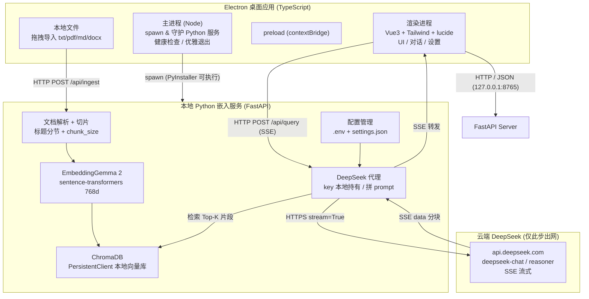

# 本地知识库助手 · 完整项目开发指南

> 基于 **DeepSeek API + 本地嵌入模型（EmbeddingGemma 2）** 的桌面知识库问答助手。
> 目标形态：**Electron 桌面应用 + 本地 Python 嵌入服务（双运行时）**，纯本地入库检索，仅生成阶段出网调用 DeepSeek。

---

## 0. 方案总览（已确认的决策）

| 决策点 | 结论 |
|---|---|
| 运行时架构 | 双运行时：Electron 壳 + 本地 Python 服务 |
| 嵌入模型 | EmbeddingGemma 2（`google/embeddinggemma-2`，768 维） |
| 向量库 | ChromaDB（PersistentClient 本地持久化） |
| 生成模型 | DeepSeek API（OpenAI 兼容），支持 SSE 流式输出，可在设置页配置 |
| 前端栈 | Vue3 + Vite + Tailwind CSS + lucide + TypeScript |
| 桌面壳 | Electron（electron-builder 打包） |
| 分发 | 当前仅 macOS（dmg），后续开源支持多平台 |

**一句话架构**：Vue3 前端负责交互，本地 Python 服务负责「文档切片 → 嵌入 → 入库 / 检索 → 拼 prompt → 代理 DeepSeek」，两者通过 HTTP + JSON 通信；DeepSeek API key 只存于 Python 服务本地配置，前端与文档检索全程不出网。

---

## 1. 系统架构



### 分层职责

| 层 | 职责 | 关键点 |
|---|---|---|
| 渲染进程 | 对话界面、知识库管理、设置页 | 不接触 API key，不直接调 DeepSeek |
| 主进程 | 拉起/守护 Python 服务、窗口管理 | 用 `contextIsolation` + preload，Node 能力不暴露给页面 |
| Python 服务 | 嵌入、向量库、检索、文档解析、DeepSeek 代理 | 唯一持有 key，唯一出网方 |
| DeepSeek | 文本生成 | 仅把「检索片段 + 问题」发出，文档全文不出网 |

---

## 2. 目录结构

```
local-knowledge-assistant/
├── package.json                 # Electron + 渲染进程脚本
├── electron/
│   ├── main.ts                  # 主进程：spawn Python、窗口、生命周期
│   ├── preload.ts               # contextBridge 暴露安全 API
│   └── backend-bootstrap.ts     # 定位/拉起后端可执行
├── src/                         # Vue3 渲染进程
│   ├── main.ts
│   ├── App.vue
│   ├── router/
│   ├── stores/                  # Pinia
│   │   ├── chat.ts
│   │   └── settings.ts
│   ├── services/
│   │   ├── api.ts               # 封装后端 HTTP / SSE
│   │   └── sse.ts               # 流式解析器
│   ├── components/
│   └── views/
│       ├── ChatView.vue         # 对话（流式）
│       ├── LibraryView.vue      # 知识库管理
│       └── SettingsView.vue     # DeepSeek key / 模型 / 流式开关 / 切片参数
├── backend/                     # Python 服务（独立 venv / uv）
│   ├── pyproject.toml
│   ├── main.py                  # FastAPI 入口 + 路由
│   ├── config.py                # 配置加载
│   ├── embedding.py             # EmbeddingGemma 2 封装
│   ├── vector_store.py          # ChromaDB 封装
│   ├── document_parser.py       # txt/pdf/md/docx 解析 + 切片
│   ├── llm.py                   # DeepSeek 代理（SSE）
│   └── requirements.txt
├── .env.example                 # DEEPSEEK_API_KEY、模型等模板
├── .gitignore
├── LICENSE
└── README.md
```

---

## 3. 开发环境搭建

### 3.1 前端（Node）
```bash
# 推荐 pnpm
pnpm create vite@latest . --template vue-ts
pnpm add electron electron-builder @electron-toolkit/utils
pnpm add tailwindcss @tailwindcss/vite lucide-vue-next pinia vue-router
pnpm add -D electron-vite
```

- Vite 集成 Tailwind（`@tailwindcss/vite` 插件）与 Vue 单文件组件。
- 用 **electron-vite** 统一管理 main / preload / renderer 三端的构建与热更新。

### 3.2 后端（Python，推荐 uv）
```bash
uv init --backend pyproject
uv add fastapi uvicorn sentence-transformers chromadb python-multipart
uv add openai  # DeepSeek 走 OpenAI 兼容接口
```

> 首次启动时 `SentenceTransformer("google/embeddinggemma-2")` 会从 HuggingFace 下载权重（约 1.5GB fp16），需网络；下载后可离线复用缓存。

---

## 4. 后端设计（核心）

### 4.1 技术栈
FastAPI + uvicorn（本地 `127.0.0.1:8765`）、sentence-transformers、ChromaDB、openai 客户端。

### 4.2 Embedding 封装（`embedding.py`）
```python
from sentence_transformers import SentenceTransformer

_model = None

def get_model() -> SentenceTransformer:
    global _model
    if _model is None:
        # 纯文本场景：关闭视觉/音频编码器，省约 470M 内存
        _model = SentenceTransformer(
            "google/embeddinggemma-2",
            config_kwargs={"vision_config": None, "audio_config": None},
        )
    return _model

def embed(texts: list[str], prompt_name: str | None = None) -> list[list[float]]:
    m = get_model()
    emb = m.encode(
        texts,
        prompt_name=prompt_name,   # "SearchQuery" / "Document" / "Classification"
        normalize_embeddings=True, # 余弦用，单位向量
    )
    return emb.tolist()
```

**关键**：检索是不对称任务——query 用 `prompt_name="SearchQuery"`，入库文档用 `"Document"`；分类/相似度用同一个前缀。前缀可显著影响检索质量。

### 4.3 ChromaDB 封装（`vector_store.py`）
```python
import chromadb
from chromadb.config import Settings

_client = None

def get_client() -> chromadb.ClientAPI:
    global _client
    if _client is None:
        _client = chromadb.PersistentClient(
            path="./data/chroma",  # 本地持久化目录
        )
    return _client

def get_collection(name="docs", space="cosine"):
    c = get_client()
    return c.get_or_create_collection(
        name=name,
        metadata={"hnsw:space": space},  # 显式用余弦相似度
    )

def add_docs(ids, texts, embeddings, metadatas):
    get_collection().add(
        ids=ids, documents=texts, embeddings=embeddings, metadatas=metadatas,
    )

def query(embedding, n_results=5, where=None):
    return get_collection().query(
        query_embeddings=[embedding], n_results=n_results, where=where,
    )
```

### 4.4 文档解析 + 切片（`document_parser.py`）
按**标题分节 + 固定长度**双策略切片，适合长文档与知识库资料：

```python
import re

def parse_file(path: str) -> str:
    # 按扩展名分流：pdf(pypdf)/docx(python-docx)/md/txt
    ...

def split_document(text: str, chunk_size=500, overlap=50) -> list[str]:
    # 策略：优先按 Markdown 标题(^#{1,6}\s)分节；小节仍过长再按 chunk_size 切，overlap 保留上下文
    sections = re.split(r"(?m)^(#{1,6}\s.+)", text)
    chunks, buffer = [], []
    for sec in sections:
        if len(sec) <= chunk_size:
            buffer.append(sec)
        else:
            # 按字符/词切，overlap
            ...
    return chunks
```

### 4.5 FastAPI 路由（`main.py`）——含 SSE 流式
```python
from fastapi import FastAPI, UploadFile
from fastapi.responses import StreamingResponse
import json

app = FastAPI()

@app.get("/api/health")
def health(): return {"status": "ok"}

@app.post("/api/ingest")
async def ingest(file: UploadFile):
    text = parse_file(await file.read())
    chunks = split_document(text)
    ids = [f"{file.filename}-{i}" for i in range(len(chunks))]
    embs = embed(chunks, prompt_name="Document")
    add_docs(ids, chunks, embs, [{"source": file.filename}] * len(chunks))
    return {"ingested": len(chunks)}

@app.post("/api/query")
async def query(body: dict):
    question = body["question"]
    q_emb = embed([question], prompt_name="SearchQuery")[0]
    hits = query(q_emb, n_results=body.get("top_k", 5))
    prompt = build_prompt(question, hits)

    async def gen():
        async for chunk in stream_deepseek(prompt, body.get("stream", True)):
            yield f"data: {json.dumps({'delta': chunk})}\n\n"

    return StreamingResponse(
        gen(), media_type="text/event-stream",
        headers={"Cache-Control": "no-cache", "X-Accel-Buffering": "no"},
    )
```

### 4.6 DeepSeek 代理（`llm.py`）——流式转发
```python
from openai import AsyncOpenAI

async def stream_deepseek(prompt: str, stream: bool, cfg):
    client = AsyncOpenAI(
        api_key=cfg.deepseek_api_key, base_url=cfg.deepseek_base_url,  # 默认 https://api.deepseek.com
    )
    resp = await client.chat.completions.create(
        model=cfg.model,            # deepseek-chat / deepseek-reasoner
        messages=[{"role": "user", "content": prompt}],
        stream=stream,
    )
    async for chunk in resp:
        if chunk.choices and chunk.choices[0].delta.content:
            yield chunk.choices[0].delta.content
```

**Prompt 组装（防止幻觉、可溯源）**：
```
你是知识库问答助手。只基于提供的资料回答；资料中没有则明确说不知道。
资料：
[1] (来源A) ...
[2] (来源B) ...

问题：{question}
```

### 4.7 配置管理（`config.py`）
- 环境变量 + `settings.json` 两级：API key 走 `.env`（不入 git），模型名 / base_url / 流式开关 / 切片参数走 settings。
- 设置页写入后端 `/api/settings`，后端即时生效。

---

## 5. 前端设计

### 5.1 页面
| 视图 | 功能 |
|---|---|
| ChatView | 对话列表、流式回答（打字机效果）、引用来源标注 |
| LibraryView | 知识库集合列表、拖拽/选择文件入库、删除文档 |
| SettingsView | DeepSeek key、base_url、model、流式开关、top_k、切片参数 |

### 5.2 流式渲染（`services/sse.ts`）
```ts
export async function* streamQuery(question: string, opts: {stream: boolean}) {
  const res = await fetch("http://127.0.0.1:8765/api/query", {
    method: "POST",
    headers: { "Content-Type": "application/json" },
    body: JSON.stringify({ question, ...opts }),
  });
  if (!res.body) return;
  const reader = res.body.getReader();
  const decoder = new TextDecoder();
  let buffer = "";
  while (true) {
    const { done, value } = await reader.read();
    if (done) break;
    buffer += decoder.decode(value, { stream: true });
    for (const line of buffer.split("\n")) {
      if (!line.startsWith("data: ")) continue;
      const payload = JSON.parse(line.slice(6));
      yield payload.delta;
    }
  }
}
```
对话组件逐段 append，实现打字机效果；`stream=false` 时后端一次性返回完整文本。

### 5.3 安全
- 渲染进程只用 `fetch` 访问后端 `127.0.0.1`，**不持有 DeepSeek key**。
- 主进程 `contextIsolation: true`、`nodeIntegration: false`，用 preload 的 `contextBridge` 暴露最小 API。

---

## 6. Electron 集成

### 6.1 主进程拉起后端（`electron/main.ts` 要点）
```ts
import { spawn } from "child_process";

const BACKEND_PORT = 8765;
let backend: ChildProcess | null = null;

async function startBackend() {
  // 开发：python -m uvicorn main:app；生产：PyInstaller 打包出的可执行文件
  backend = spawn(
    isDev ? "python" : path.join(process.resourcesPath, "backend", "server"),
    isDev ? ["-m", "uvicorn", "main:app", "--port", String(BACKEND_PORT)] : [],
    { stdio: "inherit" },
  );
  await waitForHealth(`http://127.0.0.1:${BACKEND_PORT}/api/health`);
}

function waitForHealth(url: string, tries = 30) {
  return new Promise<void>((resolve, reject) => {
    const poll = async (n: number) => {
      try { const r = await fetch(url); if (r.ok) return resolve(); }
      catch {}
      if (n <= 0) return reject(new Error("后端启动超时"));
      setTimeout(() => poll(n - 1), 500);
    };
    poll(tries);
  });
}

app.on("before-quit", () => backend?.kill());  // 优雅退出，避免孤儿进程
```

### 6.2 打包
- Python 服务用 **PyInstaller** 打成单可执行（`--onefile`），模型权重放 `resources`。
- electron-builder 打 **dmg**：`electron` 安装包 + `backend` 可执行一并进 `extraResources`。
- 注意：EmbeddingGemma 2 权重约 1.5GB（fp16），打包体积要接受；可评估是否量化以减小体积。

---

## 7. 关键数据流

### 入库（一次性，全本地）
`拖入文档 → 解析 → 切片 → EmbeddingGemma 2(768d) → 写入 ChromaDB(PersistentClient)`

### 提问（每轮，仅生成出网）
`问题 → 嵌入(SearchQuery) → ChromaDB 检索 Top-K → 拼 prompt → DeepSeek(SSE) → 流式回显`

---

## 8. 开发里程碑（建议顺序）

| 阶段 | 内容 | 验收 |
|---|---|---|
| M1 后端地基 | FastAPI + 嵌入 + ChromaDB + 切片 | 命令行能入库、能检索 top-k |
| M2 生成闭环 | DeepSeek 代理 + SSE | curl 能流式问答 |
| M3 前端壳 | Electron + Vue3 界面 + 对话流式 | 桌面内对话跑通 |
| M4 知识库页 | 拖拽入库、集合管理、设置页 | 全功能可用 |
| M5 打包 | PyInstaller + electron-builder dmg | 单机安装即用 |
| M6 开源 | README / LICENSE / CI | 可公开克隆构建 |

---

## 9. 风险与注意点

- **模型体积**：EmbeddingGemma 2 权重约 1.5GB+，注意磁盘与打包体积；纯文本场景务必关闭视觉/音频编码器省内存。
- **首次下载**：sentence-transformers 首次需联网拉权重，需在文档说明。
- **key 安全**：DeepSeek key 只在 Python 服务本地 `.env`，前端与 git 均不得出现；`.gitignore` 排除。
- **向量检索质量**：query 与 document 必须用对应任务前缀；截断维度时需重新 L2 归一化。
- **流式边界**：SSE 需关闭缓冲头；断流/超时要前端做降级提示。
- **进程生命周期**：Electron 退出必须 kill Python 子进程，避免端口占用。

---

## 10. 开源准备清单

- `.gitignore`：`.env`、`node_modules`、`dist`、`build`、`data/`（ChromaDB 本地库）、Python 缓存。
- `.env.example`：`DEEPSEEK_API_KEY=`、`DEEPSEEK_BASE_URL=https://api.deepseek.com`、`DEEPSEEK_MODEL=deepseek-chat`。
- `LICENSE`（建议 Apache-2.0，与 EmbeddingGemma 2 一致）、`README.md`（含架构图、安装、使用、开发）。
- 可选 CI：GitHub Actions 构建 mac 产物；未来扩展 Win/Linux 换 electron-builder 目标即可。
